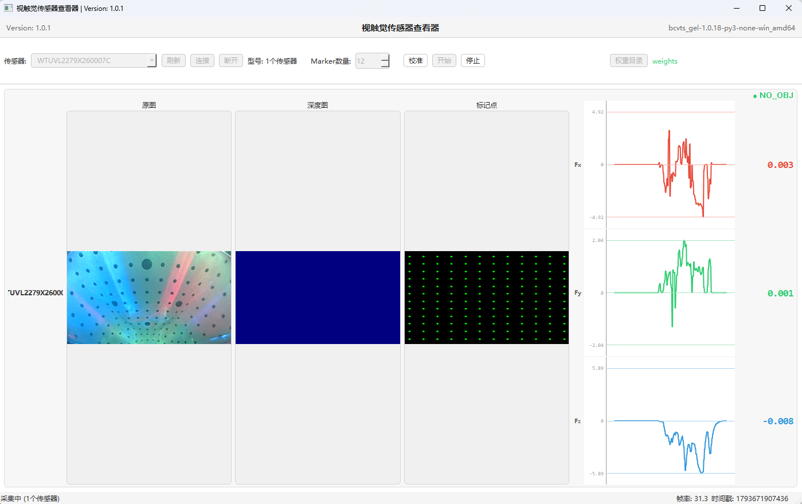

# ViTai Sensor Viewer

ViTai 视触觉传感器桌面查看器，基于 PyQt6 构建，支持实时查看传感器图像数据、力数据及滑动检测状态。

## Features

- 设备扫描与自动发现（USB）
- 实时多通道图像预览（矫正图、深度图、标记点图）
- 六维力（Fx/Fy/Fz/Mx/My/Mz）实时曲线图
- 滑动状态检测
- 传感器校准
- 自定义 ONNX 权重加载（按传感器 SN 匹配）
- 跨平台支持（Linux / Windows）

## Requirements

- Python 3.10+
- Linux x86_64 或 Windows x86_64
- ViTai 视触觉传感器硬件

## Quick Start

### 源码运行

```bash
# 1. 安装 SDK
pip install wheel/pyvitaisdk*-py3-none-linux_x86_64.whl
# Windows:
# pip install wheel/pyvitaisdk*-py3-none-win_amd64.whl

# 2. 安装依赖
pip install -r requirements.txt

# 3. 运行
python main.py
```

### 打包

将当前平台要使用的 SDK 放入 `wheel/`，每次只保留一个匹配的 wheel。支持 `pyvitaisdk-*`、`pyvitaisdk4bc-*` 和 `bcvts_gel-*`；Windows 使用 `win_amd64`，Linux 使用 `linux_x86_64`。构建会安装并内置所选 SDK，生成的程序无需外部 wheel。切换 SDK 时建议使用独立的构建环境。

```bash
python build.py
```

打包后的可执行文件在 `dist/` 目录下。

## 使用步骤



操作顺序按界面按钮编号执行：

**③ 权重目录（可选）** — 点击「权重目录」，选择包含自定义权重文件的目录。程序会按传感器 SN 自动匹配对应的 ONNX 权重。

```
BC_20260529_mini/
├── WTUVL2141X2600004/
│   ├── WTUVL2141X2600004.onnx.enc
│   └── normalization_params.json
└── WTUVL2141X2600003/
    └── ...
```

**① 连接** — 从序列号下拉框中选择传感器，点击「连接」。连接成功后自动开始采集，无需再点击「开始」。

**② 开始（停止后恢复）** — 如果按了「停止」，可点击「开始」重新采集，**无需重新连接**。

## Project Structure

```text
ViTai-Sensor-Desktop/
├── main.py                     # 程序入口
├── build.py                    # 选择并安装 SDK、生成构建信息、调用 PyInstaller 打包
├── requirements.txt            # Python 依赖（含 PyInstaller）
├── ViTaiViewer.spec            # 构建生成的 PyInstaller 配置
├── app/
│   ├── __init__.py
│   ├── build_info.py           # 自动生成的版本、分支及所选 SDK 信息
│   ├── sdk.py                  # SDK 适配层，统一 pyvitaisdk / bcvts_gel 导入
│   ├── main_window.py          # 主窗口、信号连接及采集生命周期
│   ├── sensor_worker.py        # 传感器采集线程及力模型加载
│   └── widgets/
│       ├── __init__.py
│       ├── device_panel.py     # 设备控制、权重目录选择及配置保存
│       ├── checkable_combo.py  # 支持多选的设备下拉框
│       ├── multi_sensor_viewer.py # 多传感器图像布局
│       ├── image_viewer.py     # 单传感器图像显示
│       └── data_panel.py       # 力数据曲线及滑动状态
├── wheel/                      # SDK 安装包，每个平台只保留一个待构建的 wheel
│                               # 支持 pyvitaisdk-*、pyvitaisdk4bc-*、bcvts_gel-*
├── build/                      # PyInstaller 构建中间文件（构建时生成）
├── dist/                       # 打包输出目录（构建时生成）
│   ├── ViTaiViewer.exe         # Windows 可执行程序；Linux 输出为 ViTaiViewer
│   └── settings.json           # exe 运行并保存设置时生成，记录权重目录
├── README.md                   # 中文说明
├── README_en.md                # 英文说明
└── image.png                   # 界面截图
```

源码运行时，`settings.json` 保存在项目根目录；打包后运行时，保存在可执行文件同目录。力模型放在用户选择的外部权重目录中。

## Troubleshooting

| 问题 | 解决方案 |
|------|---------|
| 传感器未识别 | 确认 USB 已连接，点击「刷新」按钮 |
| 画面卡顿 | 默认显示帧率 30fps，可修改 `main_window.py` 中 `display_freq` 参数 |
| 打包报错 `appdirs` | 已处理，确保 `build.py` 中包含 `--hidden-import appdirs` |
| 打包后 numpy 版本冲突 | 确保 numpy < 2.0，pyvitaisdk 依赖 `numpy<=1.26.4` |

## License

Internal use.
